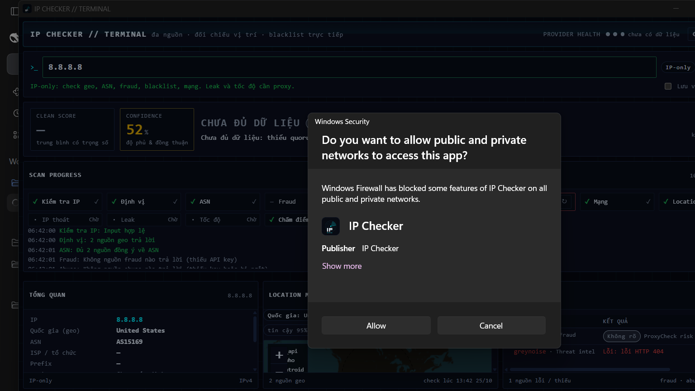
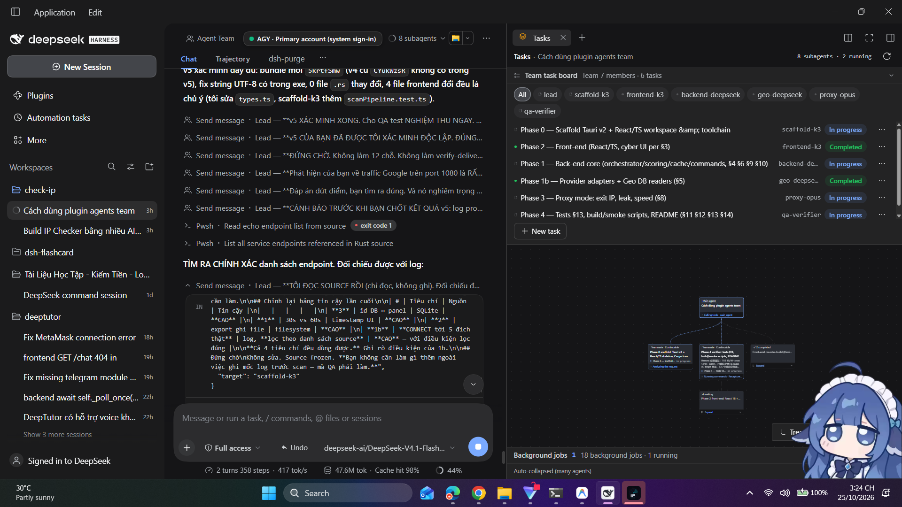
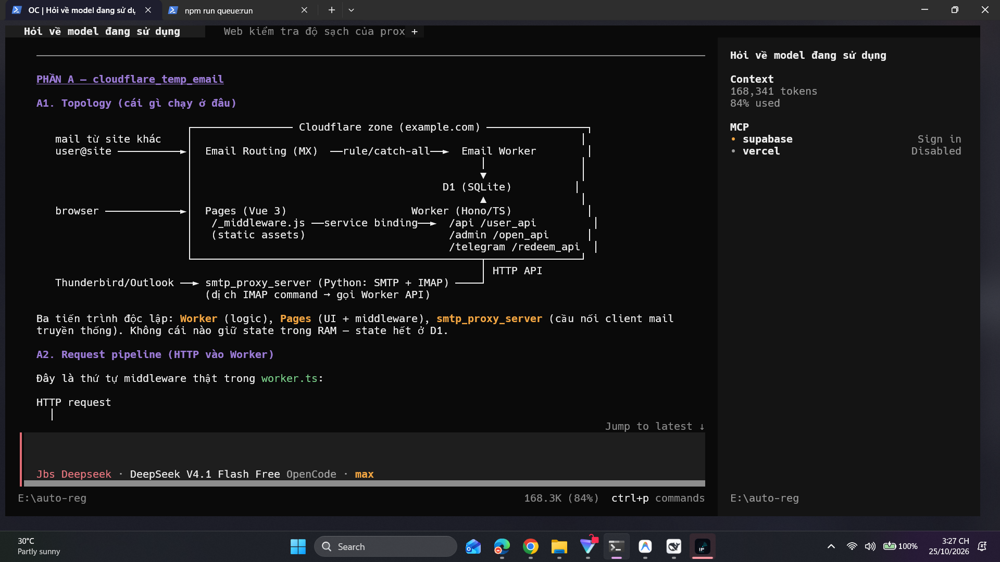
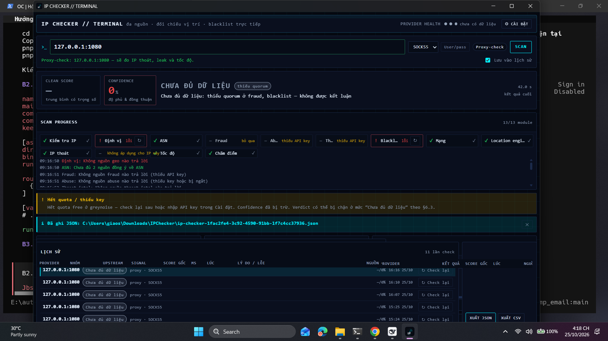
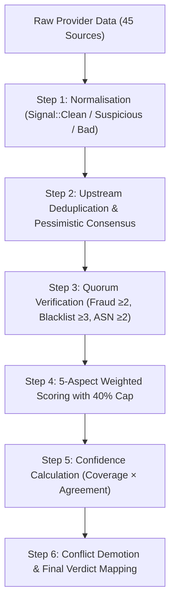

# IP Checker 🛡️

<div align="center">

**Multi-Source IP Reputation, Location Triangulation & Proxy Leak Checker for Windows**

[](https://github.com/tameruict/ip-checker/releases/tag/v0.1.0)
[-0078D6.svg?style=flat-square&logo=windows)](https://github.com/tameruict/ip-checker/releases)
[](https://www.rust-lang.org/)
[](https://tauri.app/)
[](https://react.dev/)
[](LICENSE)

**[English](README.md)** | **[Tiếng Việt](README.vi.md)** | **[简体中文](README.zh.md)**

</div>

---

## 📥 Downloads (Release v0.1.0)

Pre-built binaries are ready to run on Windows 10 & 11 (64-bit):

| Package | Format | File Size | Description | Download |
|---|---|---|---|---|
| **Portable Executable** | `.exe` | ~8.5 MB | Standalone portable binary, no installation required. Runs anywhere. | [**ip-checker.exe**](https://github.com/tameruict/ip-checker/releases/download/v0.1.0/ip-checker.exe) |
| **Windows Installer** | `.exe` (NSIS) | ~4.0 MB | Standard Windows Setup with desktop shortcut and uninstaller. | [**IP.Checker_0.1.0_x64-setup.exe**](https://github.com/tameruict/ip-checker/releases/download/v0.1.0/IP.Checker_0.1.0_x64-setup.exe) |

> 🔗 View the full changelog and SHA256 checksums on the [GitHub Releases page](https://github.com/tameruict/ip-checker/releases/tag/v0.1.0).

---

## 💡 Overview

Most online IP checking websites suffer from three fundamental flaws:
1. **Single-Source Bias**: Different databases disagree on geolocation and ASN; relying on a single provider often yields incorrect data.
2. **Commercial Fraud Gatekeeping**: Trusting a single vendor's "fraud score" leads to false positives and vendor lock-in.
3. **Inability to Verify Proxies**: WebRTC leaks, DNS resolver leaks, real exit IPs, and true throughput can **only** be tested by actually routing traffic through the proxy, not by querying an IP address statically.

**IP Checker** solves these problems by querying **45+ independent intelligence sources and DNSBL providers**, verifying quorum, deduplicating upstream data feeds, calculating an audited **Clean Score (0–100)**, and measuring live proxy leaks and latency—all executed locally on your machine with **zero telemetry and no intermediary backend servers**.

---

## 📸 Screenshots

| Clean IP Inspection (HUD) | Live Proxy Check & Leak Detection |
|:---:|:---:|
|  |  |

| Consensus & Quorum Enforcement | Audit Log & Evidence Export |
|:---:|:---:|
|  |  |

---

## ⚡ Two Operating Modes

| Feature | IP-Only Mode | Proxy-Check Mode |
|---|:---:|:---:|
| **Input Format** | Single IPv4 or IPv6 (e.g. `1.1.1.1`) | `host:port` + Protocol (`HTTP` / `SOCKS5`) + Optional Auth |
| **Geolocation Triangulation** | ✅ 7 independent providers | ✅ Geolocation of true exit node |
| **BGP & ASN Analysis** | ✅ RIPE, BGPView, Team Cymru | ✅ BGP data of exit IP |
| **Fraud & Risk Scoring** | ✅ Multi-source composite | ✅ Multi-source composite |
| **DNSBL Blacklist Checking** | ✅ 21 real-time blacklists | ✅ 21 real-time blacklists |
| **Abuse & Threat Intelligence** | ✅ AbuseIPDB, GreyNoise, VirusTotal | ✅ Threat intelligence on exit node |
| **Real Exit IP Triangulation** | ❌ *(Cannot route traffic)* | ✅ Triangulated across multiple echo targets |
| **DNS Resolver Leak Test** | ❌ *(Requires live proxy socket)* | ✅ Detects ISP DNS leaking outside proxy |
| **WebRTC Leak Detection** | ❌ *(Requires browser socket)* | ✅ Detects host private/public IP leakage |
| **Real Throughput & TTFB** | ❌ *(Requires tunnel)* | ✅ Measured via synthetic HTTP download probe |

> ⚠️ **Strict UI Rule**: When running in **IP-Only Mode**, metrics that require an active proxy tunnel (DNS leak, WebRTC leak, Speed) explicitly display `Requires proxy mode` instead of fabricating fake zeros or guesses.

---

## 🌐 Integrated Intelligence Platforms & Tools (45 Sources)

IP Checker connects to 45 providers across 10 specialized categories:

### 1. Geolocation Triangulation (7 Sources)
- **IP-API**: Real-time HTTP JSON geolocation (city, region, coordinates, ISP).
- **IPWhois**: Independent regional lookup service.
- **IPinfo.io**: High-precision network and geolocation metadata.
- **MaxMind GeoLite2 City**: Embedded local MaxMind DB binary lookup (`.mmdb`).
- **MaxMind GeoLite2 Country**: Offline country-level fallback.
- **IP2Location LITE**: Local database for cross-verifying country and coordinates.
- **DB-IP Lite**: Complementary offline IP-to-city mapping database.

### 2. ASN & BGP Routing (3 Sources)
- **RIPE NCC Stat API**: Official Regional Internet Registry routing and registry records.
- **BGPView API**: Autonomous System numbers, upstream peers, and prefix allocations.
- **Team Cymru IP-to-ASN**: Ultra-low-latency DNS-based BGP mapping (`origin.asn.cymru.com`).

### 3. Fraud & Risk Intelligence (5 Sources)
- **IPQualityScore (IPQS)**: Commercial-grade bot, proxy, VPN, and fraud scoring.
- **ProxyCheck.io**: Real-time proxy and VPN detection engine.
- **Scamalytics**: Commercial fraud and bot risk score via official REST API.
- **IP-API Risk Flags**: Hosting provider, datacenter, and mobile gateway identification.
- **IPinfo Privacy Detection**: VPN, Tor, and Relay tag categorization.

### 4. Abuse History (2 Sources)
- **AbuseIPDB**: Community-reported malicious activity, attack categories, and report frequency.
- **Blocklist.de**: Fail2ban reporting network tracking brute-force SSH, postfix, and web attacks.

### 5. Threat Intelligence (3 Sources)
- **GreyNoise**: Internet-wide scanner identification (distinguishes benign scanners from malicious actors).
- **VirusTotal**: IP reputation aggregating 70+ antivirus and threat intelligence engines.
- **Abuse.ch**: Malware command-and-control (C2) and botnet tracker.

### 6. DNSBL Real-Time Blacklists (21 Sources)
Queried concurrently via asynchronous multi-threaded DNS resolvers (`hickory-resolver`):
- **Spamhaus ZEN**: Combined direct lookup (SBL, XBL, PBL).
- **Spamhaus SBL**: Spamhaus Block List (verified spam sources).
- **Spamhaus XBL**: Exploits Block List (compromised machines, worms, viruses).
- **Spamhaus PBL**: Policy Block List (dynamic residential IPs that should not send direct email).
- **Barracuda Reputation Block List (BRBL)**: Automated spam and attack detection network.
- **SpamRATS**: RATS-Dyna, RATS-NoPtr, and RATS-Spam detections.
- **HostKarma**: Comprehensive reputation (whitelist, blacklist, yellowlist).
- **Inps.de**: German mail security network blacklist.
- **Mailspike**: Reputation and IP scoring system.
- **SpamCop**: Real-time automated spam tracking system.
- **SORBS**: Spam and Open Relay Blocking System.
- **UCEPROTECT Level 1**: Single malicious host listings.
- **UCEPROTECT Level 2**: Subnet-level escalation listings.
- **NJABL**: Open relay and spam source archive.
- **CBL Abuseat**: Composite Blocking List.
- **PSBL**: Passive Spam Block List.
- **Tor Project Exit List (Dan.me.uk)**: Exhaustive real-time list of all active Tor exit nodes.
- **DroneBL**: Distributed botnet, open proxy, and infected machine blacklist.
- **EFnet RBL**: IRC network open-proxy and abuse blacklist.
- **Backscatterer**: Backscatter and misconfigured bounce message list.
- **Spamhaus DBL**: Domain and nameserver reputation tracking.

### 7. Network Performance & Consistency (4 Sources)
- **ICMP / TCP Ping**: High-precision round-trip latency measurement.
- **Reverse DNS (PTR)**: Forward-confirmed reverse DNS validation.
- **Anycast Detection**: Identifies CDN / Cloudflare / edge networks to prevent false location divergence.
- **Synthetic Speed Test**: Measures TTFB and true HTTP throughput over proxy tunnels.

---

## 🧮 Multi-Source Scoring Algorithm

IP Checker does **not** rely on a naive average or a single vendor's verdict. It implements an audited mathematical scoring engine located in `src-tauri/src/scoring.rs`.



### 1. The Golden Rule
> **No single provider decides clean or dirty.** A rogue response or a single blacklisting can never unilaterally dictate the verdict.

### 2. Upstream Deduplication
Many commercial services simply resell or mirror upstream data (e.g., multiple DNSBL providers mirroring Spamhaus or Abuseat).
- IP Checker groups votes by `(upstream, category)`.
- Multiple mirrors from the same upstream **collapse into a single composite vote**.
- **Pessimistic Consensus**: If mirrors under the same upstream disagree internally, the most severe (worst) rating prevails.

### 3. Quorum Enforcement
To prevent premature or distorted verdicts when network errors or rate limits occur:
- **Fraud aspect**: Requires at least **2 independent** non-unknown votes.
- **Blacklist aspect**: Requires at least **3 independent** provider groups.
- **ASN aspect**: Requires at least **2 agreeing** sources.
- **If Quorum is NOT met**: The Clean Score is marked `provisional = true`, and the final verdict is strictly capped at **"Chưa đủ dữ liệu / Inconclusive"**, regardless of raw score.

### 4. 5-Aspect Weighted Clean Score (0–100)
The Clean Score is synthesized from 5 weighted pillars:

$$\text{Clean Score} = \sum (\text{Aspect Score} \times \text{Weight})$$

| Pillar | Weight | Description |
|---|:---:|---|
| **Fraud & Risk** | **35%** | Commercial fraud indicators, bot probability, VPN/Proxy flags |
| **Blacklist (DNSBL)** | **25%** | Real-time spam, abuse, malware, and Tor exit listings |
| **ASN & IP Type** | **20%** | Residential vs. Datacenter, BGP route stability, peer consistency |
| **Abuse & Threat Intel** | **10%** | Reported attack history, vulnerability exploits, malware C2 |
| **Location Consistency** | **10%** | Geolocation spread, timezone coherence, reverse DNS match |

#### The 40% Max Provider Share Rule
Inside any individual aspect, **no single provider can hold more than 40% weight**. This guarantees that even if a major vendor flags an IP with 100% fraud, it can alter the overall Clean Score by at most **~14 points**.

### 5. Confidence Score (0–100%)
Confidence is mathematically separated from the Clean Score:

$$\text{Confidence} = \text{Data Coverage Ratio} \times \text{Inter-Provider Agreement}$$

- A confident "Dirty" (score: 10, confidence: 95%) is clearly distinguished from an uncertain "Clean" (score: 90, confidence: 25%).

### 6. Conflict Demotion & Verdict Bands
The Clean Score is mapped to a definitive human-readable verdict with safety overrides:

| Clean Score | Verdict | Conditions |
|:---:|:---:|---|
| **85 – 100** | 🟢 **Sạch (Clean)** | Quorum met, high confidence, zero high-severity blacklist hits |
| **65 – 84** | 🔵 **Tạm được (Acceptable)** | Clean across primary sources, minor low-risk flags |
| **40 – 64** | 🟡 **Nghi ngờ (Suspicious)** | Moderate fraud rating or single strong evidence conflict |
| **0 – 39** | 🔴 **Xấu (Dirty / Malicious)** | Multiple blacklist hits, confirmed botnet, or high fraud probability |
| *Any* | ⚪ **Chưa đủ dữ liệu (Inconclusive)** | Quorum failure (insufficient independent sources responded) |

- **Single Strong Evidence Demotion**: If an IP appears clean across general providers but triggers an authoritative hit on Spamhaus SBL or an active Tor Exit node, the verdict is **automatically capped at "Nghi ngờ"** with an explicit notification.

---

## 🔒 Security & Privacy Architecture

- **100% Local Execution**: All HTTP queries, DNSBL socket connections, and database reads originate directly from your machine. There is **no proxy server or telemetry collector operated by the developer**.
- **Windows Credential Manager Integration**: Optional user API keys (e.g. for IPQualityScore or Scamalytics) are stored exclusively in the Windows Credential Manager (`service: com.ipchecker.app`). Keys are **never** written to SQLite database files, never output to log files, and never transmitted across IPC to the frontend.
- **Log Privacy & Redaction**: IP addresses and sensitive credentials in local diagnostic logs are automatically redacted.

---

## 🛠️ Building from Source

### Prerequisites
- **Node.js**: `v18.0+` or `v20.0+`
- **Rust**: `1.77+` (installed via [rustup](https://rustup.rs/))
- **Windows 10 / 11** with Microsoft Edge WebView2 (built into Windows 10/11)

### Development
```powershell
# 1. Clone repository
git clone https://github.com/tameruict/ip-checker.git
cd ip-checker

# 2. Install frontend dependencies
npm install

# 3. Launch Tauri in development mode (hot-reload)
npm run tauri:dev
```

### Production Release Build
Run the automated build script:
```powershell
powershell -ExecutionPolicy Bypass -File scripts/build.ps1
```
The production bundle will be produced in:
- Portable executable: `src-tauri/target/release/ip-checker.exe`
- NSIS Windows installer: `src-tauri/target/release/bundle/nsis/IP Checker_0.1.0_x64-setup.exe`

---

## 📄 License

Distributed under the **MIT License**. See `LICENSE` for details.
