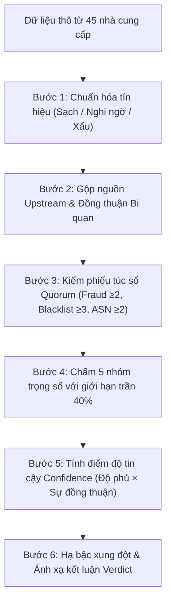

# IP Checker 🛡️

<div align="center">

**Công cụ kiểm tra độ sạch IP, định vị đa nguồn & phát hiện rò rỉ Proxy chuyên sâu cho Windows**

[](https://github.com/tameruict/ip-checker/releases/tag/v0.1.0)
[-0078D6.svg?style=flat-square&logo=windows)](https://github.com/tameruict/ip-checker/releases)
[](https://www.rust-lang.org/)
[](https://tauri.app/)
[](https://react.dev/)
[](LICENSE)

**[English](README.md)** | **[Tiếng Việt](README.vi.md)** | **[简体中文](README.zh.md)**

</div>

---

## 📥 Tải về bản cài đặt (Release v0.1.0)

Phần mềm đã được đóng gói sẵn sàng sử dụng trên hệ điều hành Windows 10 & 11 (64-bit):

| Gói cài đặt | Định dạng | Dung lượng | Mô tả | Liên kết tải |
|---|---|---|---|---|
| **Bản chạy ngay (Portable)** | `.exe` | ~8.5 MB | File thực thi độc lập, không cần cài đặt. Tải về nhấp đúp là chạy ngay. | [**ip-checker.exe**](https://github.com/tameruict/ip-checker/releases/download/v0.1.0/ip-checker.exe) |
| **Bộ cài đặt Windows** | `.exe` (NSIS) | ~4.0 MB | Trình cài đặt tiêu chuẩn, tự tạo shortcut Desktop, Start Menu và gỡ cài đặt sạch sẽ. | [**IP.Checker_0.1.0_x64-setup.exe**](https://github.com/tameruict/ip-checker/releases/download/v0.1.0/IP.Checker_0.1.0_x64-setup.exe) |

> 🔗 Xem chi tiết danh sách cập nhật và mã băm SHA256 tại [Trang phát hành GitHub Releases](https://github.com/tameruict/ip-checker/releases/tag/v0.1.0).

---

## 💡 Giới thiệu tổng quan

Hầu hết các trang web kiểm tra IP hiện nay đều mắc phải 3 nhược điểm cố hữu:
1. **Thiên vị một nguồn (Single-Source Bias)**: Mỗi cơ sở dữ liệu (MaxMind, IP-API, IP2Location) định vị một toạ độ khác nhau; tin vào 1 trang duy nhất thường cho kết quả lệch hàng nghìn km.
2. **Điểm gian lận (Fraud Score) độc quyền**: Dựa vào 1 bên đánh giá duy nhất rất dễ gặp báo động giả (False Positive) hoặc bị ép mua gói dịch vụ đắt đỏ.
3. **Không thể kiểm tra Proxy thực tế**: Rò rỉ WebRTC, rò rỉ DNS, IP cổng thoát thật và tốc độ mạng thực tế **chỉ có thể đo được** khi thực sự định tuyến lưu lượng qua kết nối proxy, không thể đo bằng cách nhập IP chay trên web.

**IP Checker** ra đời để giải quyết triệt để vấn đề này bằng cách đối soát dữ liệu từ **hơn 45 nguồn tình báo độc lập và danh sách đen (DNSBL)**, áp dụng thuật toán kiểm phiếu đồng thuận (Quorum), gộp nguồn trùng lặp và tính toán điểm **Clean Score (0–100)** minh bạch, đo trực tiếp rò rỉ proxy ngay tại máy bạn mà **không thông qua bất kỳ máy chủ trung gian nào**.

---

## 📸 Hình ảnh giao diện ứng dụng

### 1. Giao diện Terminal & Điểm Clean Score HUD
> Điểm Clean Score tổng hợp (0–100), tỷ lệ độ tin cậy, kết luận đồng thuận (Verdict), và tiến độ quét thời gian thực qua 13 module.


### 2. Phân tích đa nguồn chuyên sâu & Chẩn đoán DNSBL
> Tam giác vị trí địa lý với cảnh báo độ lệch khoảng cách, đối soát uy tín đa nguồn, kiểm tra 21+ danh sách đen DNSBL thời gian thực, và chẩn đoán mạng ICMP.


### 3. Cài đặt bảo mật & Quản lý API Key (Windows Credential Manager)
> Lưu trữ mã khóa API trực tiếp vào Windows Credential Manager bảo mật, tùy chỉnh nhóm DNSBL, giới hạn luồng đồng thời và thư mục xuất báo cáo kiểm toán.

<p align="center">
  
</p>

---

## ⚡ Hai chế độ hoạt động — Quy chuẩn minh bạch

| Tính năng | Chế độ chỉ kiểm tra IP (IP-Only) | Chế độ kiểm tra Proxy (Proxy-Check) |
|---|:---:|:---:|
| **Đầu vào** | 1 địa chỉ IPv4 hoặc IPv6 (VD: `1.1.1.1`) | `host:port` + Giao thức (`HTTP` / `SOCKS5`) + Xác thực |
| **Tam giác vị trí (Geo)** | ✅ Đối soát 7 nhà cung cấp | ✅ Định vị tọa độ của IP cổng thoát thật |
| **Phân tích BGP & ASN** | ✅ RIPE NCC, BGPView, Team Cymru | ✅ Dữ liệu định tuyến của node thoát |
| **Chấm điểm rủi ro & gian lận** | ✅ Đa nguồn kết hợp (Scamalytics, IPQS,...) | ✅ Đa nguồn kết hợp |
| **Tra cứu danh sách đen** | ✅ Quét song song 21 DNSBL | ✅ Quét song song 21 DNSBL |
| **Lịch sử lạm dụng & mã độc** | ✅ AbuseIPDB, GreyNoise, VirusTotal | ✅ Tình báo mã độc tại node thoát |
| **Xác định IP thoát thật** | ❌ *(Không có luồng traffic)* | ✅ Tam giác cổng thoát qua nhiều echo endpoint |
| **Phát hiện rò rỉ DNS** | ❌ *(Cần kết nối socket proxy)* | ✅ Phát hiện DNS của nhà mạng lộ ra ngoài |
| **Phát hiện rò rỉ WebRTC** | ❌ *(Cần socket trình duyệt)* | ✅ Phát hiện rò rỉ IP riêng/công cộng của máy |
| **Đo tốc độ thực & TTFB** | ❌ *(Cần kết nối đường hầm)* | ✅ Tải gói tin thực tế đo độ trễ & băng thông |

> ⚠️ **Quy tắc hiển thị nghiêm ngặt**: Khi ở chế độ **IP-Only**, các mục cần đường hầm proxy (Rò rỉ DNS, WebRTC, Tốc độ) sẽ hiển thị thông báo rõ ràng `Chưa đo được — cần nhập proxy`, **tuyệt đối không hiển thị số 0 giả lập hay bịa số liệu**.

---

## 🌐 45 Nền tảng & Công cụ dùng để chấm điểm

Hệ thống kết nối và xử lý dữ liệu từ 45 nguồn thuộc 10 nhóm chuyên biệt:

### 1. Tam giác vị trí địa lý (7 nguồn)
- **IP-API**: API JSON thời gian thực (quốc gia, vùng, thành phố, tọa độ, ISP).
- **IPWhois**: Dịch vụ tra cứu địa lý khu vực độc lập.
- **IPinfo.io**: Cơ sở dữ liệu IP và tổ chức mạng độ chính xác cao.
- **MaxMind GeoLite2 City**: Cơ sở dữ liệu nhị phân MaxMind tích hợp sẵn (`.mmdb`).
- **MaxMind GeoLite2 Country**: Cơ sở dữ liệu quốc gia ngoại tuyến dự phòng.
- **IP2Location LITE**: Database ngoại tuyến đối soát quốc gia và tọa độ.
- **DB-IP Lite**: Database ánh xạ thành phố mã nguồn mở bổ trợ.

### 2. Định tuyến BGP & Hệ thống tự trị ASN (3 nguồn)
- **RIPE NCC Stat API**: Dữ liệu định tuyến chính thức từ Trung tâm Điều phối Mạng lưới Châu Âu.
- **BGPView API**: Tra cứu số ASN, nhà mạng cấp trên (peers) và dải IP công bố.
- **Team Cymru IP-to-ASN**: Hệ thống truy vấn ASN qua giao thức DNS độ trễ cực thấp (`origin.asn.cymru.com`).

### 3. Tình báo gian lận & Rủi ro IP (5 nguồn)
- **IPQualityScore (IPQS)**: Đánh giá xác suất bot, proxy, VPN và gian lận thương mại.
- **ProxyCheck.io**: Nền tảng chuyên phát hiện VPN, proxy thương mại thời gian thực.
- **Scamalytics**: Đánh giá chỉ số rủi ro gian lận (Fraud Score) qua REST API chính thức.
- **IP-API Risk Flags**: Nhận diện hạ tầng hosting, trung tâm dữ liệu (Datacenter) và mạng di động.
- **IPinfo Privacy**: Định danh thẻ VPN, Tor và Apple Private Relay.

### 4. Lịch sử lạm dụng & Báo cáo vi phạm (2 nguồn)
- **AbuseIPDB**: Mạng lưới cộng đồng báo cáo địa chỉ IP tấn công, spam và quét cổng.
- **Blocklist.de**: Hệ thống Fail2ban giám sát các cuộc tấn công Brute-force SSH, mail server.

### 5. Tình báo mối đe dọa an ninh (3 nguồn)
- **GreyNoise**: Phân loại các máy quét toàn cầu (phân biệt công cụ nghiên cứu lành tính và mã độc).
- **VirusTotal**: Tập hợp kết quả đánh giá danh tiếng IP từ hơn 70 engine bảo mật hàng đầu thế giới.
- **Abuse.ch**: Theo dõi các máy chủ điều khiển mã độc (C2) và mạng botnet nguy hiểm.

### 6. Danh sách đen DNSBL thời gian thực (21 nguồn)
Truy vấn bất đồng bộ đa luồng trực tiếp qua máy chủ DNS phân tán (`hickory-resolver`):
- **Spamhaus ZEN**: Bộ tra cứu tổng hợp danh tiếng (SBL, XBL, PBL).
- **Spamhaus SBL**: Danh sách nguồn phát tán thư rác đã xác minh.
- **Spamhaus XBL**: Danh sách máy tính bị cài mã độc, worm, trojan làm bot.
- **Spamhaus PBL**: Danh sách IP gia đình động không được phép gửi email trực tiếp.
- **Barracuda BRBL**: Danh sách đen của hệ thống bảo mật thư điện tử Barracuda.
- **SpamRATS**: Bộ phát hiện RATS-Dyna, RATS-NoPtr và RATS-Spam.
- **HostKarma**: Hệ thống danh tiếng tổng hợp (Whitelist, Blacklist, Yellowlist).
- **Inps.de**: Mạng giám sát thư rác nước Đức.
- **Mailspike**: Hệ thống xếp hạng danh tiếng IP gửi mail theo thang điểm.
- **SpamCop**: Mạng lưới phản ứng nhanh theo dõi thư rác tự động.
- **SORBS**: Hệ thống phát hiện máy chủ trung chuyển mở (Open Relay) và spam.
- **UCEPROTECT Level 1**: Danh sách IP đơn lẻ phát tán vi phạm.
- **UCEPROTECT Level 2**: Danh sách leo thang theo dải subnet mạng.
- **NJABL**: Kho lưu trữ máy chủ open relay và nguồn spam.
- **CBL Abuseat**: Danh sách chặn hỗn hợp (Composite Blocking List).
- **PSBL**: Danh sách chặn thụ động Passive Spam Block List.
- **Tor Project Exit List (Dan.me.uk)**: Danh sách toàn bộ các node cổng thoát mạng Tor đang hoạt động.
- **DroneBL**: Danh sách chặn botnet phân tán và proxy mở độc hại.
- **EFnet RBL**: Danh sách đen máy chủ proxy lạm dụng trên mạng chat IRC.
- **Backscatterer**: Danh sách nguồn gửi tin phản hồi thư rác sai cấu hình.
- **Spamhaus DBL**: Danh sách tên miền và máy chủ DNS độc hại.

### 7. Đo kiểm mạng & Sự nhất quán (4 nguồn)
- **ICMP / TCP Ping**: Đo độ trễ phản hồi mạng chính xác đến từng mili-giây.
- **Reverse DNS (PTR)**: Xác minh ánh xạ ngược tên miền máy chủ có khớp chiều thuận.
- **Phát hiện mạng Anycast**: Nhận diện CDN (Cloudflare, Fastly,...) để tránh cảnh báo sai lệch vị trí.
- **Kiểm tra tốc độ mô phỏng**: Đo độ trễ phản hồi gói đầu tiên (TTFB) và tốc độ tải thực qua proxy.

---

## 🧮 Thuật toán chấm điểm đa nguồn chuyên sâu

Thuật toán của IP Checker không tính trung bình cộng đơn giản, mà áp dụng mô hình toán học nghiệm thu chặt chẽ nằm tại `src-tauri/src/scoring.rs`.



### 1. Nguyên tắc vàng
> **Không có bất kỳ nhà cung cấp đơn lẻ nào có quyền quyết định kết luận Sạch hay Xấu.** Mọi dữ liệu đều phải được đối soát chéo.

### 2. Gộp nguồn trùng lặp (Upstream Deduplication)
Nhiều dịch vụ trên mạng chỉ đóng gói lại hoặc bán lại dữ liệu từ một nguồn gốc (ví dụ nhiều dịch vụ DNSBL thực chất lấy lại dữ liệu từ Spamhaus hoặc CBL).
- Thuật toán gom nhóm phiếu bầu theo cặp `(upstream, category)`.
- Các đại lý/bản sao của cùng một nguồn gốc chỉ tính **DUY NHẤT 1 phiếu bầu đại diện**.
- **Đồng thuận Bi quan**: Nếu các nhánh con của cùng 1 nguồn mâu thuẫn dữ liệu, kết quả xấu nhất sẽ được chọn để đảm bảo tính an toàn.

### 3. Cơ chế kiểm phiếu túc số (Quorum Enforcement)
Tránh việc đưa ra kết luận vội vã khi mạng bị ngắt quãng hoặc bị chặn quota:
- **Nhóm Fraud**: Yêu cầu tối thiểu **2 nguồn độc lập** có kết quả rõ ràng.
- **Nhóm Blacklist**: Yêu cầu tối thiểu **3 nhóm danh sách đen** độc lập phản hồi.
- **Nhóm ASN**: Yêu cầu tối thiểu **2 nguồn** thống nhất loại IP.
- **Khi KHÔNG đủ túc số**: Điểm số được gắn nhãn tạm thời (`provisional = true`), và kết luận bị chặn trần ở mức **"Chưa đủ dữ liệu"**, không cho phép kết luận an toàn giả mạo.

### 4. 5 Trọng số cấu thành điểm Clean Score (0–100)
Điểm số độ sạch được tổng hợp theo công thức:

$$\text{Clean Score} = \sum (\text{Điểm nhóm} \times \text{Trọng số})$$

| Nhóm đánh giá | Trọng số | Nội dung đánh giá |
|---|:---:|---|
| **Gian lận & Rủi ro (Fraud)** | **35%** | Xác suất bot, rủi ro giao dịch, cờ VPN/Proxy |
| **Danh sách đen (Blacklist)** | **25%** | Lịch sử spam, dính bẫy mã độc, node mạng Tor |
| **Hệ thống mạng (ASN & Type)** | **20%** | Mạng dân dụng (Residential) vs Datacenter, định tuyến BGP |
| **Lạm dụng & Mã độc (Abuse)** | **10%** | Báo cáo tấn công cộng đồng, máy chủ điều khiển botnet |
| **Nhất quán vị trí (Consistency)**| **10%** | Khoảng cách tọa độ giữa các DB, múi giờ, rDNS |

#### Giới hạn trần 40% (Max Provider Share)
Trong mỗi nhóm đánh giá, **không một nhà cung cấp nào được chiếm quá 40% tỷ trọng của nhóm đó**. Quy tắc toán học này triệt tiêu hoàn toàn rủi ro: nếu một nhà mạng chấm gian lận 100%, điểm tổng toàn app bị trừ tối đa **~14 điểm**.

### 5. Điểm tin cậy độc lập (Confidence Score 0–100%)
Độ tin cậy được tính toán tách biệt hoàn toàn khỏi điểm sạch:

$$\text{Confidence} = \text{Tỷ lệ nguồn phản hồi} \times \text{Mức độ đồng thuận giữa các nguồn}$$

- Phân biệt rành mạch giữa một IP "Chắc chắn Xấu" (Điểm: 10, Tin cậy: 98%) và một IP "Sạch nhưng mập mờ" (Điểm: 95, Tin cậy: 20%).

### 6. Hạ bậc xung đột & Thang bậc kết luận
Điểm số được chuyển dịch thành kết luận trực quan có các biện pháp can thiệp an toàn:

| Điểm Clean Score | Kết luận | Điều kiện áp dụng |
|:---:|:---:|---|
| **85 – 100** | 🟢 **Sạch** | Đủ túc số Quorum, độ tin cậy cao, không dính danh sách đen nghiêm trọng |
| **65 – 84** | 🔵 **Tạm được** | Dữ liệu đa phần sạch, có vài cờ cảnh báo rủi ro thấp |
| **40 – 64** | 🟡 **Nghi ngờ** | Điểm rủi ro trung bình hoặc xuất hiện xung đột chứng cứ quan trọng |
| **0 – 39** | 🔴 **Xấu** | Dính nhiều danh sách đen, botnet hoặc tỷ lệ gian lận cao |
| *Bất kỳ* | ⚪ **Chưa đủ dữ liệu** | Thiếu túc số Quorum (quá ít nhà cung cấp phản hồi thành công) |

- **Quy tắc hạ bậc chứng cứ cứng (Single Strong Evidence)**: Dù điểm trung bình tính ra rất cao, nhưng nếu IP bị phát hiện nằm trong danh sách Spamhaus SBL hoặc là node cổng thoát Tor đang hoạt động, hệ thống lập tức **hạ bậc kết luận tối đa xuống "Nghi ngờ"** và nêu rõ nguyên nhân cảnh báo.

---

## 🔒 Kiến trúc An toàn & Bảo mật

- **100% Xử lý nội bộ trên máy bạn**: Toàn bộ kết nối HTTP, socket phân giải DNSBL, đọc cơ sở dữ liệu đều thực hiện trực tiếp từ máy của bạn. **Không có bất kỳ máy chủ trung gian hay hệ thống thu thập dữ liệu nào của nhà phát triển**.
- **Lưu trữ API Key qua Windows Credential Manager**: Các khóa API do bạn thêm vào (IPQS, Scamalytics) được lưu trữ an toàn trong két sắt phần mềm Windows Credential Manager (`service: com.ipchecker.app`). Khóa API **không bao giờ** ghi ra file SQLite, không ghi vào file log và không truyền ngược về giao diện webview.
- **Xóa mờ dữ liệu nhạy cảm trong log**: Các file log chẩn đoán cục bộ tự động làm mờ địa chỉ IP và mã khóa.

---

## 🛠️ Hướng dẫn tự Build từ mã nguồn

### Yêu cầu môi trường
- **Node.js**: Phiên bản `v18.0+` hoặc `v20.0+`
- **Rust**: Phiên bản `1.77+` (cài qua [rustup](https://rustup.rs/))
- **Windows 10 / 11** kèm Microsoft Edge WebView2

### Cài đặt và chạy thử nghiệm
```powershell
# 1. Tải mã nguồn về máy
git clone https://github.com/tameruict/ip-checker.git
cd ip-checker

# 2. Cài đặt các gói phụ thuộc giao diện
npm install

# 3. Khởi chạy ứng dụng trong chế độ nhà phát triển (hot-reload)
npm run tauri:dev
```

### Đóng gói bản phát hành Release
Chạy script đóng gói tự động chuẩn:
```powershell
powershell -ExecutionPolicy Bypass -File scripts/build.ps1
```
File hoàn chỉnh sẽ nằm tại thư mục:
- Bản Portable: `src-tauri/target/release/ip-checker.exe`
- Trình cài đặt NSIS: `src-tauri/target/release/bundle/nsis/IP Checker_0.1.0_x64-setup.exe`

---

## 📄 Giấy phép

Dự án được phân phối dưới giấy phép **MIT License**. Chi tiết xem tại file `LICENSE`.
