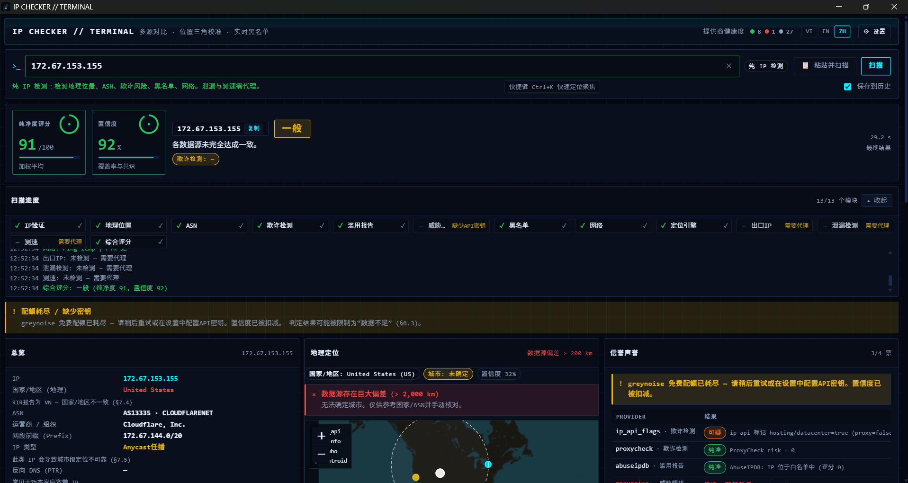
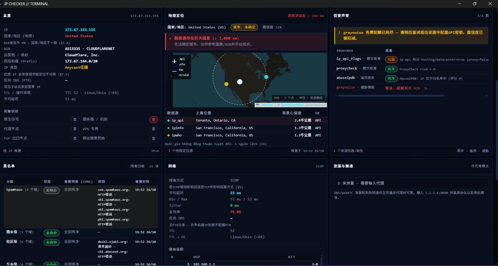
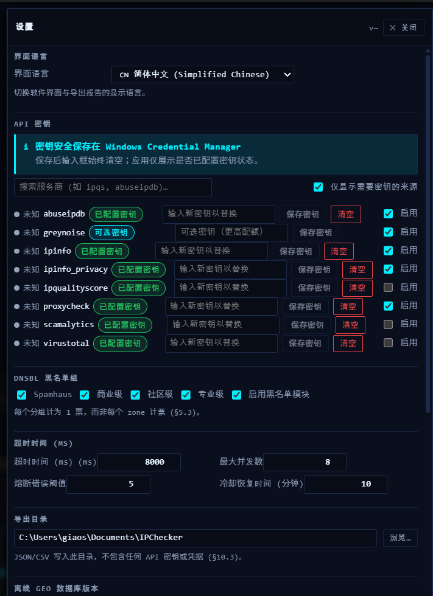
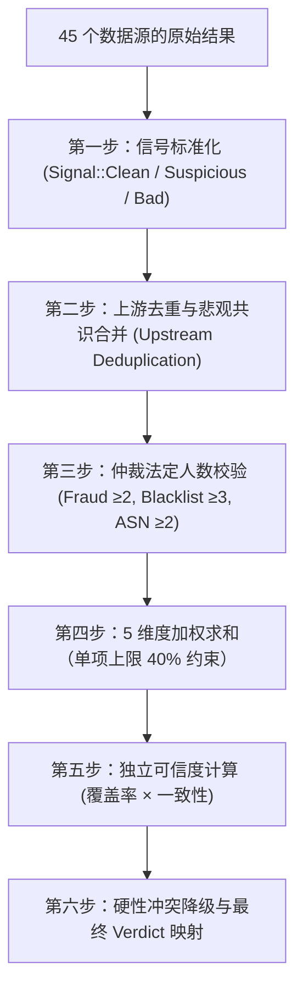

# IP Checker 🛡️

<div align="center">

**专为 Windows 设计的多源 IP 信誉评估、位置交叉校验与代理泄漏检测工具**

[](https://github.com/tameruict/ip-checker/releases/tag/v0.1.0)
[-0078D6.svg?style=flat-square&logo=windows)](https://github.com/tameruict/ip-checker/releases)
[](https://www.rust-lang.org/)
[](https://tauri.app/)
[](https://react.dev/)
[](LICENSE)

**[English](README.md)** | **[Tiếng Việt](README.vi.md)** | **[简体中文](README.zh.md)**

</div>

---

## 📥 软件下载 (Release v0.1.0)

已构建完成并可直接在 Windows 10 & 11 (64位) 上运行：

| 安装包类型 | 文件格式 | 文件大小 | 功能描述 | 下载链接 |
|---|---|---|---|---|
| **免安装便携版 (Portable)** | `.exe` | 约 8.5 MB | 单文件直接运行，无需安装，随存随用。 | [**ip-checker.exe**](https://github.com/tameruict/ip-checker/releases/download/v0.1.0/ip-checker.exe) |
| **标准安装包 (Installer)** | `.exe` (NSIS) | 约 4.0 MB | 包含桌面快捷方式与完整卸载向导的标准 Windows 安装程序。 | [**IP.Checker_0.1.0_x64-setup.exe**](https://github.com/tameruict/ip-checker/releases/download/v0.1.0/IP.Checker_0.1.0_x64-setup.exe) |

> 🔗 完整变更日志及 SHA256 校验和请查看 [GitHub Releases 页面](https://github.com/tameruict/ip-checker/releases/tag/v0.1.0)。

---

## 💡 产品概述

目前市面上的 IP 查询工具大多存在三大根本痛点：
1. **单一数据源偏差**：不同数据库对同一 IP 的地理定位与 ASN 归属经常存在冲突；仅依赖单个查询站点往往造成上千公里的偏差。
2. **商业欺诈评分黑盒**：单一商业供应商给出的欺诈评分（Fraud Score）极易误报，且数据不透明。
3. **无法真实验证代理状态**：WebRTC 泄漏、DNS 泄漏、真实出口 IP 以及网络传输吞吐量，**只有在流量真实经过代理隧道时才能测出**，无法仅凭静态输入 IP 地址获知。

**IP Checker** 综合汇聚了 **45+ 个独立的网络情报源与 DNSBL 黑名单**，引入仲裁多数派（Quorum）机制、上游数据去重算法以及公开透明的 **Clean Score 纯净度评分（0–100）**，并在本地直接发起代理泄漏检测与性能基准测试。**无任何中间商转发服务器，无用户隐私采集**。

---

## 📸 运行截图

### 1. 终端总览与纯净度评分 (Clean Score HUD)
> 实时综合纯净度评分 (0–100)、置信度百分比、仲裁法定结论与 13 大模块扫描进度跟踪。



### 2. 多源深度情报交叉比对与 DNSBL 诊断
> 地理位置多源交叉三角定位与距离偏差预警、信誉评分仲裁、21+ 权威 DNSBL 黑名单实时查验与 ICMP 网络诊断。



### 3. 系统设置与凭据加密存储 (Windows Credential Manager)
> 结合 Windows 凭据管理器进行 API 密钥本地安全加密存储、DNSBL 分组启闭、并发上限及审计报告导出路径配置。

<p align="center">
  
</p>

---

## ⚡ 两种核心运行模式

| 功能特性 | 仅查 IP 模式 (IP-Only) | 代理测试模式 (Proxy-Check) |
|---|:---:|:---:|
| **输入格式** | 单个 IPv4 或 IPv6 地址（例：`1.1.1.1`） | `IP:端口` + 协议 (`HTTP` / `SOCKS5`) + 可选认证 |
| **地理位置交叉定位** | ✅ 7 大独立来源对比 | ✅ 定位代理真实出口节点的地理位置 |
| **BGP 与 ASN 路由分析** | ✅ RIPE NCC, BGPView, Team Cymru | ✅ 出口节点的 BGP 拓扑与路由信息 |
| **多源欺诈与风险评估** | ✅ 综合加权评分 (Scamalytics, IPQS 等) | ✅ 综合加权评分 |
| **DNSBL 实时黑名单检测** | ✅ 21 个权威黑名单并发检测 | ✅ 21 个权威黑名单并发检测 |
| **历史滥用与威胁情报** | ✅ AbuseIPDB, GreyNoise, VirusTotal | ✅ 出口节点的历史滥用记录 |
| **真实出口 IP 校验** | ❌ *(无实际网络传输)* | ✅ 结合多个回显服务端进行交叉三角定位 |
| **DNS 污染与解析泄漏检测** | ❌ *(需真实代理套接字)* | ✅ 探测运营商 DNS 是否绕过代理泄漏 |
| **WebRTC 本地私网泄漏检测** | ❌ *(需浏览器环境套接字)* | ✅ 探测本机局域网/公网 IP 是否泄漏 |
| **真实网络延迟与下载测速** | ❌ *(需代理隧道连接)* | ✅ 发起真实 HTTP 下载探针测算 TTFB 与速率 |

> ⚠️ **界面数据原则**：在 **仅查 IP 模式** 下，凡是必须依赖代理隧道的数据卡片（DNS泄漏、WebRTC泄漏、速度测试）将明确显示 `需要切换至代理模式`，**严禁显示虚假的 0 或伪造猜测数据**。

---

## 🌐 45 个情报平台与数据评估源

工具支持覆盖 10 大分类维度的 45 个权威数据源：

### 1. 地理位置交叉定位 (7 个数据源)
- **IP-API**：实时 HTTP JSON 地理定位（国家、地区、城市、经纬度、ISP）。
- **IPWhois**：独立的区域 IP 归属查询接口。
- **IPinfo.io**：高精度组织与网络归属信息库。
- **MaxMind GeoLite2 City**：内置本地离线 MaxMind 二进制数据库 (`.mmdb`)。
- **MaxMind GeoLite2 Country**：离线国家级兜底数据库。
- **IP2Location LITE**：离线国家代码与坐标比对数据库。
- **DB-IP Lite**：轻量级开源城市级映射库。

### 2. ASN 与 BGP 路由拓扑 (3 个数据源)
- **RIPE NCC Stat API**：欧洲网络协调中心官方路由及注册信息。
- **BGPView API**：全球自治系统（ASN）、上游 Peer 节点与网段宣告。
- **Team Cymru IP-to-ASN**：基于超低延迟 DNS 协议的 BGP 映射 (`origin.asn.cymru.com`)。

### 3. 欺诈与安全风险评分 (5 个数据源)
- **IPQualityScore (IPQS)**：商业级机器人、代理、VPN 及欺诈风险评分。
- **ProxyCheck.io**：实时代理与商业 VPN 识别引擎。
- **Scamalytics**：通过官方 REST API 获取权威欺诈评分（Fraud Score）。
- **IP-API Risk Flags**：识别机房 Hosting、数据中心及移动网络网关。
- **IPinfo Privacy**：识别 VPN、Tor 及 Apple Private Relay 隐私中继标识。

### 4. 历史滥用行为记录 (2 个数据源)
- **AbuseIPDB**：全球社区发起的攻击、垃圾邮件及暴力扫描举报记录。
- **Blocklist.de**：基于 Fail2ban 系统的 SSH、邮件及 Web 攻击实时拦截网络。

### 5. 威胁情报与恶意软件 (3 个数据源)
- **GreyNoise**：全网扫描器特征识别（清晰区分良性扫描器与恶意攻击者）。
- **VirusTotal**：集成 70+ 家杀毒软件与网络安全厂商的 IP 综合信誉。
- **Abuse.ch**：恶意软件僵尸网络（Botnet）与 C2 控制服务器追踪。

### 6. 21 大 DNSBL 实时反垃圾与安全黑名单
基于底层异步多线程 DNS 解析器 (`hickory-resolver`) 极速并发查询：
- **Spamhaus ZEN**：综合黑名单（包含 SBL, XBL, PBL）。
- **Spamhaus SBL**：经核实的垃圾邮件发送源。
- **Spamhaus XBL**：受恶意软件、蠕虫病毒感染的肉鸡设备。
- **Spamhaus PBL**：禁止直接对外发送邮件的动态住宅宽带列表。
- **Barracuda BRBL**：Barracuda 实时反垃圾信誉黑名单。
- **SpamRATS**：RATS-Dyna、RATS-NoPtr 和 RATS-Spam 组合识别。
- **HostKarma**：白名单、黑名单、黄名单综合评估体系。
- **Inps.de**：德国邮件安全网络监测黑名单。
- **Mailspike**：邮件信誉梯队量化分级系统。
- **SpamCop**：自动化垃圾邮件快速反应拦截网络。
- **SORBS**：开放中继（Open Relay）及滥用拦截系统。
- **UCEPROTECT Level 1**：单个高风险恶意主机列表。
- **UCEPROTECT Level 2**：子网与路由广播级上浮拉黑列表。
- **NJABL**：中继与垃圾邮件历史节点归档库。
- **CBL Abuseat**：复合拦截名单 (Composite Blocking List)。
- **PSBL**：被动式垃圾邮件拦截名单 (Passive Spam Block List)。
- **Tor Project Exit List (Dan.me.uk)**：全网所有活跃 Tor 出口节点的实时白皮书。
- **DroneBL**：受感染僵尸网络与开放恶意中继黑名单。
- **EFnet RBL**：IRC 聊天网络恶意代理与滥用节点列表。
- **Backscatterer**：错误反弹邮件投递拦截列表。
- **Spamhaus DBL**：域名与恶意名称服务器信誉名单。

### 7. 本地网络测试与指标一致性 (4 个探针)
- **ICMP / TCP Ping**：高精度的网络往返时延（RTT）探测。
- **反向 DNS 解析 (PTR)**：验证域名双向解析（FCrDNS）一致性。
- **Anycast 广播识别**：自动识别 Cloudflare 等 CDN 节点，消除因任播导致的位置偏差假阳性。
- **合成测速探针**：测量真实代理链路下的首包响应时间（TTFB）与实际下载带宽。

---

## 🧮 多源加权打分与仲裁算法

IP Checker 绝非简单计算平均数，而是在 `src-tauri/src/scoring.rs` 中完整实现了经数学证明的防偏差共识模型。



### 1. 核心铁律
> **没有任何单个供应商可以单方面决定一个 IP 的纯净或肮脏。** 任何孤立的异常数据都受到算法的约束与平衡。

### 2. 上游数据去重 (Upstream Deduplication)
行业内许多查询站点或 DNSBL 实际上只是转手包装了相同的上游数据源（例如多家服务商均基于 Spamhaus 或 CBL）。
- 算法统一按照 `(upstream, category)` 进行投票归组。
- 来自同一上游的多个下游分销源或镜像仅计算 **1 票代表权**。
- **悲观共识原则**：若同一上游的多级镜像数据产生矛盾，系统自动采用最严重（最差）的结果，以最大化防范安全风险。

### 3. 法定人数仲裁 (Quorum Enforcement)
防止在遭遇网络抖动或 API 配额耗尽时给出片面虚假的结论：
- **欺诈评估维度**：至少需要 **2 个独立且非 Unknown 的有效结果**。
- **黑名单维度**：至少需要 **3 个独立的供应商组** 进行交叉投票。
- **ASN 维度**：至少需要 **2 个相互印证的来源**。
- **法定人数不足时**：计算出的 Clean Score 会自动附加 `provisional = true` 暂定标签，最终结论强制封顶为 **"Chưa đủ dữ liệu (数据不足)"**，绝不武断下结论。

### 4. 5 维度加权 Clean Score (0–100)
纯净度综合分数的计算公式为：

$$\text{Clean Score} = \sum (\text{维度分值} \times \text{维度权重})$$

| 评定维度 | 权重占比 | 核心评定内容 |
|---|:---:|---|
| **欺诈与风控 (Fraud)** | **35%** | 商业风控概率、机器人行为识别、VPN/代理标记 |
| **反垃圾黑名单 (Blacklist)** | **25%** | 垃圾邮件发送史、僵尸网络、Tor 出口节点 |
| **网络自治域 (ASN & Type)** | **20%** | 家庭宽带住宅 IP vs 机房托管 IP，BGP 路由稳定性 |
| **滥用与威胁情报 (Abuse)** | **10%** | 全球社区攻击举报频次、C2 控制端记录 |
| **信息一致性 (Consistency)** | **10%** | 多个定位库的经纬度离散度、时区一致性、反向解析匹配度 |

#### 40% 单源权重硬上限
在任何单个细分维度内部，**没有任何供应商能占有超过 40% 的权重**。这一数学限制确保：即使某商业服务商误判该 IP 为 100% 极度危险，其对全盘最终纯净度的最大下拉影响也绝对不会超过 **约 14 分**。

### 5. 独立可信度指标 (Confidence Score 0–100%)
可信度与纯净度分数完全解耦，独立计算：

$$\text{Confidence} = \text{数据源有效响应覆盖率} \times \text{各源间结果一致度}$$

- 严谨区分“确凿的垃圾 IP”（得分：10，可信度：98%）与“信息缺失的伪纯净 IP”（得分：95，可信度：20%）。

### 6. 强冲突降级与结论矩阵
系统根据综合得分将 IP 映射为直观评级，并设有安全兜底机制：

| Clean Score | 综合评级 | 触发条件 |
|:---:|:---:|---|
| **85 – 100** | 🟢 **Sạch (纯净)** | 法定人数满足，高可信度，无任何高危黑名单拦截 |
| **65 – 84** | 🔵 **Tạm được (尚可)** | 绝大多数源正常，仅存在轻微低风险标记 |
| **40 – 64** | 🟡 **Nghi ngờ (可疑)** | 存在中度风险评分或核心指标出现冲突 |
| **0 – 39** | 🔴 **Xấu (高危/污染)** | 被多家权威黑名单拦截、确认为僵尸网络或极高欺诈率 |
| *任意* | ⚪ **Chưa đủ dữ liệu (数据不足)** | 未达到法定仲裁人数（有效响应的独立来源过少） |

- **重大单一证据降级（Single Strong Evidence）**：即使其他辅助源评分尚可，一旦命中权威的 Spamhaus SBL 列表或确认处于活跃的 Tor 出口节点中，系统将**自动触发硬性熔断，将评级直接降级并封顶至“可疑 (Nghi ngờ)”**，并在界面显著提示风险成因。

---

## 🔒 隐私与安全架构

- **100% 客户端本地执行**：所有的 HTTP 请求、DNSBL 解析套接字与数据库文件均直接由你的本地电脑发起。**开发团队不存在任何收集数据的中转服务器**。
- **Windows 凭据管理器硬件级存储**：用户可选配置的商业 API 密钥（如 IPQualityScore 或 Scamalytics）统一妥善加密保存在 Windows 凭据管理器 (`service: com.ipchecker.app`) 中。密钥**绝不**保存在本地 SQLite 数据库中，不写入任何日志文件，更不跨 IPC 向前端界面透传。
- **日志敏感信息自动脱敏**：本地诊断日志中的 IP 地址及私密凭据均经过自动模糊化脱敏过滤。

---

## 🛠️ 从源码构建指南

### 环境准备
- **Node.js**：`v18.0+` 或 `v20.0+`
- **Rust**：`1.77+`（建议通过 [rustup](https://rustup.rs/) 安装）
- **Windows 10 / 11** 系统已内置 Microsoft Edge WebView2 环境

### 本地调试与运行
```powershell
# 1. 克隆代码仓库
git clone https://github.com/tameruict/ip-checker.git
cd ip-checker

# 2. 安装前端依赖
npm install

# 3. 启动开发模式（支持热重载）
npm run tauri:dev
```

### 生产版本自动化打包
运行自动化发布打包脚本：
```powershell
powershell -ExecutionPolicy Bypass -File scripts/build.ps1
```
构建产物将输出在：
- 便携单文件版：`src-tauri/target/release/ip-checker.exe`
- NSIS 标准安装包：`src-tauri/target/release/bundle/nsis/IP Checker_0.1.0_x64-setup.exe`

---

## 📄 开源许可

本项目遵循 **MIT License** 开源协议发布。详情请参阅 `LICENSE` 文件。
